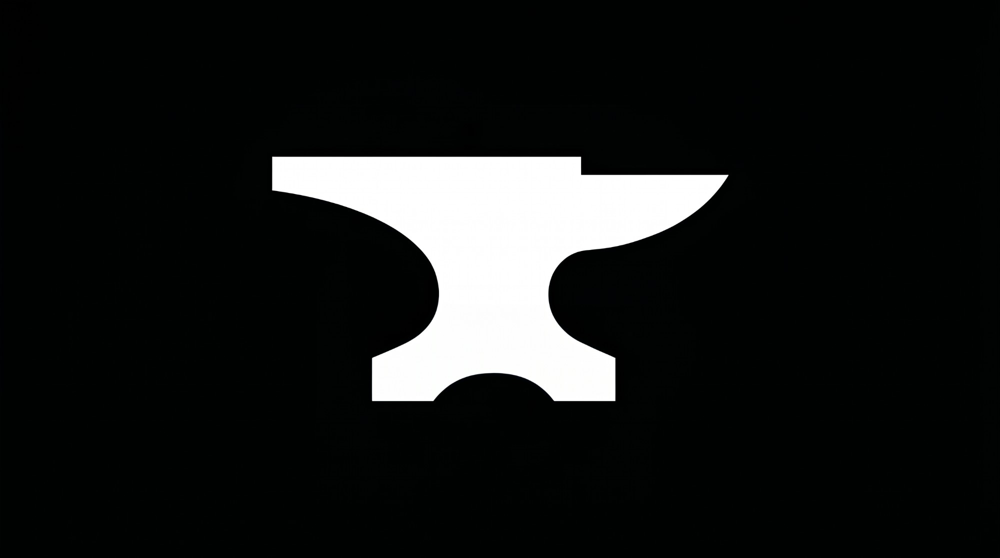

# Bezalel — 3º motor da Nathanael Industries



- **Status:** Conceito (aparência pronta, com dados de demonstração)
- **Classificação:** Criador de IAs.
- **Cores:** preto e verde.
- **Logo:** bigorna branca sobre fundo preto. A bigorna é onde o artesão dá forma às peças, assim como o Bezalel dá forma às IAs.
- **Origem do nome:** Bezalel, o artesão escolhido para construir o tabernáculo (Êxodo 31).

## Linha de produção
```
Gather (APIs) → Fornalha (funde e prova) → BEZALEL (molda a IA) → IA pronta
            Asafe sustenta tudo (infraestrutura)
```

## Responsável por (proposta)
- Definição de novas IAs (propósito, personalidade, regras).
- Montagem das IAs, unindo a estrutura do Asafe e as APIs do Gather.
- Controle de versões e melhorias.
- Aposentadoria de IAs antigas.
- Registro das IAs criadas no Asafe.
- Será o motor que construirá o **Horácio** (HoV 1.1) e o **Miquéias** (JpG 1.0).

**Diferença para o Gather:** o Gather dá ferramentas (APIs) às IAs; o Bezalel cria as IAs.

**Não faz:** testes e avaliação (isso é da **Fornalha**, na prova de fogo); criar APIs (isso é do **Gather**).

## Submotores (ainda não produzidos — nomes temporários)
| Código | Nome | Pilar | O que sustenta |
|---|---|---|---|
| BZL-C | **Baluarte** | Continuidade | Nenhuma IA em construção se perde: salva o progresso e retoma a criação |
| BZL-M | **Baú** | Memória | Lembra como cada IA foi criada (receita, versões) e aprende com as criações anteriores |
| BZL-A | **Bússola** | Autonomia | Propõe melhorias e novas versões das IAs sem esperar pedido |

## Ordem de criação
Asafe → Gather → Fornalha → **Bezalel** (4ª fase) → Submotores → Horácio e Miquéias.

## Aparência (site/painel)
Só visual, sem back-end, com dados de demonstração; mesmo padrão do site do Asafe em preto e verde.

| Arquivo | O quê |
|---|---|
| `index.html` | Página (abra direto no navegador) |
| `styles.css` | Tema preto e verde |
| `app.js` | Abas e dados de demonstração |
| `assets/bezalel.jpg` | Logo (bigorna) |
| `PROMPT-APARENCIA.md` | Prompt usado para gerar a aparência |

Telas: Painel geral · Bigorna (oficina) · Definição de IA · Catálogo de IAs · Versões e aposentadoria · Submotores.

> Transferido do repositório `companynathanael/NATHANAEL-INDUSTRIES` (pasta `bezalel/`), que agora guarda só as ideias centrais e a conversa com o Sr. Nathanael.
